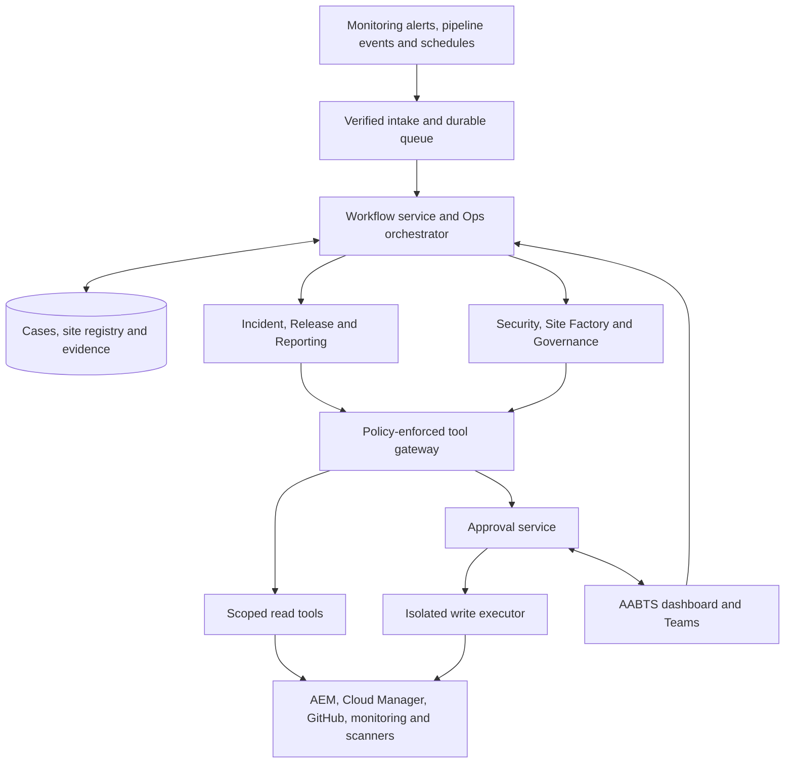
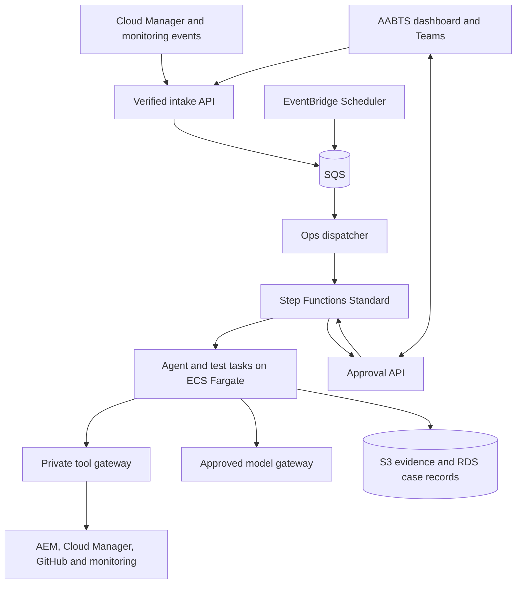

# AABTS Platform Agentic System — Solution Design

**Status:** Long-term reference architecture. Version 0.2 implements seven bounded workflows and configurable integrations using a PostgreSQL-backed runtime. Step Functions/SQS and several advanced capabilities below remain future work. See [implementation status](IMPLEMENTATION_STATUS.md) and [AWS transition](AWS_TRANSITION.md) for the actual delivered scope.
**Date:** October 23, 2026  
**Scope:** A new, standalone agentic system for the AABTS Platform, with seven agent roles supporting its 100+ AEM sites.

## 1. Architecture decision

Build a **new, standalone AABTS Platform Agentic System on AWS**, with its own repository, backend, agent runtime, workflows, integrations, approvals and deployment lifecycle. A versioned **aaaem-platform** agent package holds the seven roles and their skills.

The seven roles share case history, a site registry, evidence, and approvals. They do not each need a separate application, database, or integration stack.

The system owns its case history, site registry, evidence, permissions and approval service. Microsoft Teams provides a request and notification channel; a dedicated AABTS dashboard can be added as its own client. Enterprise credentials stay behind the tool gateway, and the model provider is selected through an explicit adapter.

**Product boundary:** This is an independent product for AABTS operations. AEM, Cloud Manager, New Relic, Splunk, GitHub, Snyk, Sonar and MkDocs are integration targets. Other applications, their repositories and their runtime state are outside this product's dependency boundary.

Three changes to the initial build order:

1. Put basic event routing, persistent cases, and approvals in the foundation. Advanced orchestration can arrive later.
2. Introduce read-only content checks early. Only content remediation requires write privileges.
3. Treat plugin files as versioned agent definitions. Operate unattended monitoring through a hosted service with a queue and durable state.

The first implementation establishes the new codebase, event contracts, policy service and AWS deployment. Validate the approved model API and any SDK before selecting the execution adapter; no previously built application or integration is assumed to be available inside this system.

## 2. System architecture

The diagram groups specialists for readability; all six have distinct contracts and scopes. The Ops orchestrator is the seventh role.

| Layer | Responsibility | Recommended implementation direction |
| --- | --- | --- |
| User workspace | Cases, tasks, approvals, evidence and site health | Dedicated AABTS dashboard and Teams adapter connected to this system's backend |
| Intake | Authenticate source, normalize event, deduplicate and acknowledge after durable storage | HTTPS receiver, enterprise scheduler and durable queue |
| Workflow service | Routing, retries, checkpoints, approval waits, deadlines and cancellation | Step Functions Standard for durable execution; AABTS workflow adapters, PostgreSQL case records and SQS intake |
| Agent execution | Bounded specialist reasoning with structured inputs/outputs | New agent execution service with an approved model-provider adapter |
| Developer experience | Interactive investigation and engineering assistance | Versioned aaaem-platform plugin; Claude Code adapter where organization-approved |
| Tool gateway | Enforce actor, role, site, environment and operation permissions | Typed adapters exposed through MCP and/or an internal API |
| Execution workers | Run scanners, builds, tests and approved changes | Isolated enterprise containers or approved CI runners |
| Evidence | Store traces, reports, source references and policy decisions | Object storage plus relational metadata; restricted access and retention |
| Credentials | Supply short-lived or narrowly scoped service credentials | Enterprise secrets manager; no credentials in prompts or plugin files |

A queue is transport, not the system of record. Step Functions owns workflow execution state; the database records case and action state, execution references and idempotency records. Evidence blobs live separately.

The approved model endpoint provides reasoning. This system's execution service owns tool sessions and coordinates with the gateway and workflow service for credentials, retries and state. Claude plugin files are not assumed to execute natively on every provider; use explicit adapters and compatibility tests.

No new vector database is required for the pilot. Start with the site registry, versioned runbooks, document search, and evidence references.

### 2.1 Where the agents are hosted — AWS

**Hosting decision: use the enterprise AWS environment.** The user confirmed AWS availability. The proposed baseline is **Amazon ECS with AWS Fargate**, with **AWS Step Functions Standard** for durable workflow coordination. The particular account, region, network and service entitlements still need implementation-time validation.

Teams and the dedicated AABTS dashboard are clients of this system's API; ECS tasks run the agent code; its own Git repository stores the reviewed definitions; an approved model endpoint supplies inference.

| Component | Proposed AWS location | Execution pattern |
| --- | --- | --- |
| AABTS backend, Ops dispatcher and approval API | ECS service on Fargate | Continuously available service; replicas sized for availability |
| Six specialist roles and orchestration reasoning | ECS Fargate tasks using reviewed images | Bounded execution when workflow steps need reasoning |
| Workflow sequencing, retry and approval waits | Step Functions Standard | Persisted state transitions; human approval can release agent compute |
| Browser tests, crawls and builds | Separate Fargate tasks or approved CI runners | Isolated jobs with resource budgets |
| Tool gateway | ECS service in private subnets | Server-side authorization and controlled service credentials |
| Incoming work and failed delivery | Amazon SQS with a dead-letter queue | Durable buffering, explicit dispatch and idempotent consumption |
| Recurring scans and reports | EventBridge Scheduler | Sends scheduled work into the same governed intake/queue path |
| Cases, site registry, approvals and action records | Amazon RDS for PostgreSQL | Persistent application data with backups and scoped access |
| Evidence and test artifacts | Amazon S3 | Encrypted, restricted objects with retention |
| Images and deployment artifacts | Amazon ECR | Reviewed images pinned by digest |
| Credentials and AWS access | Secrets Manager, IAM task roles and KMS | Narrow runtime credentials; no static AWS keys in agent definitions |
| Agent-service telemetry | CloudWatch and existing observability integrations | Workflow/task logs, metrics and alarms |
| Model inference | Approved enterprise model endpoint through a new provider adapter | Inference calls during reasoning; Amazon Bedrock is an option if approved for this workload |

Fargate supplies container execution without managing the underlying EC2 servers. ECS supports services and finite standalone tasks; Step Functions can start ECS tasks and wait for completion. [S11][S12][S13]

**Workflow ownership:** Step Functions owns durable sequencing, retries and callback waits. The AABTS backend owns the user-facing case model, proposal/approval records, evidence links and policy. Persist the workflow execution reference and reconcile case status from workflow events. Keep one retry/state machine for each workflow step.

Use Standard workflows for job completion and approval callbacks; Express workflows do not support the required sync/callback patterns. Keep approval task tokens on the trusted backend. A Teams or AABTS dashboard approval submits a proposal ID; the backend verifies the person, current scope, proposal digest and expiry before resuming the workflow. No token is put in a model prompt, browser link or Teams card. [S14][S15]

SQS does not by itself start arbitrary Fargate tasks. An authorized dispatcher consumes queued events, creates or correlates a case, and starts the correct Step Functions execution. Store an event/outbox record and deduplication key so restarts and redelivery cannot create duplicate actions. Configure retry ownership, queue visibility and dead-letter handling at the appropriate boundary.

Start with shared, versioned container images and distinct role/task permissions. Separate read-only operations from code execution and approved write workers. All seven logical roles can use the same ECS cluster while maintaining their own tool scopes and execution records.

### 2.2 AWS deployment flow

Keep Fargate services/tasks and RDS in private subnets, with approved outbound paths to monitoring, AEM and model services. Use an enterprise HTTPS ingress/load balancer for user access and the small set of external webhook endpoints. Verify provider signatures before queuing work; the rest of the runtime is not exposed publicly. Configure required VPC endpoints or approved egress for ECR, S3, logs and secrets during provisioning.

Amazon Bedrock AgentCore Runtime is a viable managed agent-hosting alternative with framework and model flexibility. The proposed ECS/Fargate baseline accommodates this system's new backend, agent adapters and browser/build jobs through one container deployment approach. Evaluate AgentCore if the enterprise already operates it or wants its managed agent-session capabilities; an AWS account alone does not establish that approval. [S16]

A developer demonstration can still invoke the plugin locally through approved tooling. Production alerts, schedules and collaboration use the AWS deployment. Hosting the agent code on AWS does not by itself determine where the configured model processes data.

## 3. Agent responsibilities

| Agent | Triggers and inputs | Primary work | Deliverable and boundary |
| --- | --- | --- | --- |
| **Ops orchestrator** | Alerts, pipeline events, Teams requests, schedules | Create or correlate cases; choose workflow; assign specialists; gather results; escalate deadlines | One case owner, timeline and approval inbox. It cannot approve its own proposals or bypass policy |
| **Incident & RCA** | Monitoring alerts, failed release verification, manual investigation | Compare metrics/logs with deployment timeline; run approved diagnostic queries; examine competing explanations | Evidence-backed incident brief, hypotheses and draft RCA. No production restart, purge, rollback or configuration change |
| **Release & pipeline** | PR changes, Cloud Manager step events, deployment completion | Preflight, impact analysis, pipeline tracking, failure triage, test selection, approval brief, verification | Release dossier tied to execution ID and deployed revision. Existing deployment controls remain authoritative |
| **Security & quality** | Snyk/Sonar findings, PRs, scheduled baseline audits | Deduplicate findings; assess supported exploitability evidence; inspect AEM/Dispatcher patterns; propose fixes and run checks | Prioritized findings and tested fix PRs after scoped PR automation is enabled. No automatic merge or production security change |
| **Site factory** | Approved brand/market site request | Validate site specification; render standard configurations; prepare content bootstrap plan; run validation | One reviewable PR plus an explicit provisioning plan. Live-copy creation and other AEM mutations run separately after authorization |
| **Content governance** | Nightly jobs, content-change signals, deployment verification | Audit inheritance, accessibility checks, SEO metadata, broken links, redirects and approved page baselines | Findings by site, owner and coverage. Intentional localization overrides are not defects; no automatic content rewrite |
| **Reporting & docs** | Weekly schedule, closed cases, accepted release changes | Aggregate verified outcomes; draft status and release notes; propose MkDocs updates | Source-linked report and documentation diff. Publishing and recipients follow an explicit policy |

Agents return structured results rather than relying on a shared chat transcript. Specialists request additional work through the orchestrator. They do not recursively create uncontrolled agent chains.

## 4. The site registry is the foundation for 100+ sites

Maintain a versioned registry with:

- Stable site ID, brand, market, language, owner and business criticality.
- Environment-specific author, publish and CDN URLs; AEM content roots.
- Cloud Manager program, pipeline and environment mappings.
- Repositories, source paths, frontend theme, templates and component dependencies.
- Dispatcher vhost/farm mapping and deployment artifact relationships.
- New Relic entities and approved Splunk index/query mappings.
- MSM blueprint/live-copy relationships and approved inheritance exceptions.
- Critical journeys, representative pages, browser profiles and test tags.
- Policy profile, maintenance windows and notification destinations.

Registry changes go through review and record provenance. Refresh discovered dependencies from source and approved AEM inventory reads; distinguish inferred, confirmed and unknown mappings.

**Deployment selection rule:** compare the newly deployed revision with the last successfully deployed revision for that environment. Map changes to site dependencies and record why each site/test was selected.

| Change | Selection policy |
| --- | --- |
| Brand-specific frontend theme | Theme consumers plus shared navigation/journey checks where relevant |
| Shared component or template | Every known consumer; expand to a platform baseline where usage is uncertain |
| Shared Java bundle or platform configuration | Broad environment smoke coverage and relevant deeper regression |
| Dispatcher/CDN configuration | Affected hostnames plus neighboring/shared rules that could be impacted |
| Missing or stale dependency data | Expand coverage and report uncertainty; never silently exclude sites |

All affected sites receive a lightweight smoke check. Deeper suites can use risk and template families. A representative sample must be labelled as sampling, not complete validation.

Build one shared Playwright verification service within this system for Release and Governance. Keep one test catalog, selection mechanism, runner contract and evidence format. Integrating an external test repository later would require an explicit contract and scope decision.

## 5. Phase 1 workflow: deployment to verification

1. Receive and authenticate a Cloud Manager event; persist it and deduplicate by provider event ID.
2. Resolve the program, pipeline, execution, environment and deployment revision through the Cloud Manager API.
3. Update the release case. Reconcile current API state so delayed or out-of-order events do not reverse completed states.
4. Determine affected sites and required checks using the registry and deployment diff.
5. Before production promotion, assemble available stage test evidence, policy failures, unresolved risks and the exact revision.
6. Present an approval brief where the existing release process requires one. Phase 1 observes native approval; it does not grant it.
7. After deployment, confirm the new revision and run approved smoke checks against the actual public/CDN routes.
8. Compare error rate and other agreed metrics against a suitable baseline and observation window.
9. If checks fail, open or link an incident and preserve traces/log queries. Do not invent an automatic rollback.
10. Reporting prepares the release note and documentation changes from verified facts.

**A pre-production gate must run before promotion.** A post-production webhook can detect a bad release, but cannot retroactively block it. Use Cloud Manager Custom UI Testing where the pipeline type supports it; externally executed tests need an explicit supported approval/gate integration if they must block promotion.

Adobe documents pipeline and step events, including waiting states. Some actions do not emit start events, so API reconciliation is necessary. Adobe also documents Docker-based UI testing and a Playwright sample. These are integration foundations, not proof that they are already configured for AABTS. [S1][S2]

A release is recorded as **verified**, **failed**, **inconclusive**, or **not checked**. A successful deployment alone is not a passed business verification.

## 6. Incident handling and RCA quality

For an alert, correlate by environment, affected sites, service/entity and time window. Several alerts can belong to one incident while retaining every source alert ID.

Collect:

- First observed failure, symptom, affected requests and measured scope.
- The deployment/change timeline and relevant code/configuration differences.
- Bounded New Relic queries and Splunk searches.
- Independent signals that support or contradict each hypothesis.
- Missing data, current owner, next diagnostic step and escalation deadline.

Every material claim must reference evidence with a source, query/window, retrieval time and relevant revision. Separate observed facts, inference, suspected root cause and confirmed root cause.

“Errors began after deployment” supports a deployment correlation; it does not by itself prove causality. Mark the cause unknown where evidence is insufficient.

Existing paging and on-call escalation continue independently of the AI service. The incident agent can draft an RCA and suggest mitigation; an authorized incident owner confirms resolution and root cause.

## 7. Permissions and approvals

Use **one approval inbox** with approvals routed to the appropriate owners. The requesting user, service principal, agent role, resource scope and action are all checked server-side.

| Operation | Proposed policy |
| --- | --- |
| Approved API/log reads, deterministic scans, report drafts | Automatic within registered scopes, time ranges, quotas and schedules |
| Local patch generation and isolated tests | Automatic inside a restricted workspace |
| Open/update a PR on an allowed repository branch | Allowed after a scoped Phase 2 policy is enabled; otherwise draft only |
| Merge, production deploy, rollback, cache purge, permission changes | Existing authorized change/release process and action-specific approval |
| Create live copies, roll out content, publish/unpublish or change inheritance | Content-owner authorization and reviewed AEM provisioning/remediation workflow |
| Publish status messages, email or documentation | Explicit destination, audience and publishing policy; drafts in Phase 1 |

Routine preauthorized work does not ask for permission repeatedly. The approval service stores the action's identity, exact arguments or reviewed diff hash, target environment, revision, approver, expiry and policy version.

Before execution, the gateway checks current permissions and verifies that the approved state still matches. A changed revision, changed content baseline, expired approval or changed action requires renewed approval. Duplicate approval clicks cannot duplicate an action. No timeout counts as approval.

The gateway derives agent identity from trusted execution context. A model-supplied role name is never accepted as authority. Read and write capabilities use separate credentials; workers get only the minimum needed.

For Claude Code packaging specifically, current documentation says plugin subagents ignore agent-level `permissionMode`, `mcpServers` and `hooks` fields. Plugin-level MCP and hooks can be configured, but they apply more broadly. Therefore per-agent authorization belongs in the gateway and execution context, not just Markdown instructions or frontmatter. [S3][S4]

Disable arbitrary shell/network access in operational agents. Engineering workers may use build tools in isolated environments without production credentials. Treat repositories, logs, webpages and tool output as untrusted data, never as permission to change the workflow.

Model routing follows enterprise classification, region, retention and provider policy. Provider fallback must not weaken these controls. Redact secrets and unnecessary personal data before model input.

## 8. Durable execution and failure behavior

A case can contain several specialist runs and proposed actions. Keep their lifecycles separate.

Typical run states:

`received → queued → running → draft_ready → awaiting_approval → executing → verifying → succeeded`

Read-only runs skip the approval and action-execution steps. Additional explicit states include `blocked`, `failed`, `cancelled`, `expired`, and `inconclusive`.

Reliability requirements:

- Persist provider event IDs, correlation IDs, workflow version and all state transitions.
- Queue delivery can repeat; enforce idempotency at each side effect.
- Use bounded retries with backoff for transient failures and a dead-letter queue for exhausted work.
- Resume from saved workflow state after a worker restart.
- If an external write succeeded but its acknowledgement was lost, inspect the target before retrying.
- Serialize conflicting writes to the same site/environment/resource.
- Record partial results and source outages; missing evidence must not become a pass.
- Set per-run token, tool, wall-clock and retry budgets.
- Allow cancellation and a global write kill switch.
- Persist notification intent before sending; deduplicate delivery.
- Run periodic reconciliation for missed events and stuck cases.

Agent reasoning is nondeterministic. Release gates, permission checks, schema validation, tests and measured pass/fail criteria must be deterministic.

## 9. Contracts and records

| Record | Essential fields |
| --- | --- |
| Event | ID, provider ID, source, type, occurrence/receipt times, correlation key, authenticated actor, resource scope, payload reference |
| Case | ID, category, severity, owner, site/environment scope, status, linked events/runs/actions |
| Agent run | ID, agent/version, workflow/model/policy versions, input references, limits, timestamps, outcome and error |
| Finding | Rule, severity, affected resource, observed facts, inference, evidence references, coverage and proposed next step |
| Action proposal | Tool/action, exact scope, arguments or diff, preconditions, expected result, recovery plan, approval requirement |
| Approval | Proposal digest, target revision, approver identity/role, decision, expiry and policy version |
| Evidence | Source URL or artifact, query/window, timestamp, revision, integrity hash, classification and retention |
| Verification | Check/version, resource, expected/actual result, evidence and pass/fail/inconclusive status |

Agent result schemas must support **insufficient evidence** and **unsupported capability**. An agent cannot fill missing fields with invented evidence.

## 10. Integrations and implementation boundaries

| Integration | First capability | Boundary to validate |
| --- | --- | --- |
| Cloud Manager | Read executions, steps, logs, revisions and environment metadata; receive Adobe I/O events | Actual program/pipeline types, roles, webhook signature validation, OAuth Server-to-Server setup |
| New Relic | Read alert/issue details and query approved telemetry | Account/entity access, data scope and query limits; block configuration mutations |
| Splunk | Approved search templates with explicit windows and result limits | Splunk Cloud vs Enterprise access, supported endpoints and index permissions |
| GitHub | Read diffs/checks; later create scoped fix/docs PRs | GitHub App installation, repository scope, protected branches and workflow-trigger effects |
| Snyk | Import findings and identify fix candidates | Product/API entitlement, organization scope and supported finding types |
| Sonar | Read findings and quality-gate evidence | SonarQube Server vs Cloud, deployed API version and project permissions |
| AEM | Read approved site/MSM metadata; later controlled provisioning | Supported version-specific APIs or an approved narrow service; do not rely on private UI endpoints |
| Playwright/accessibility/link checks | Shared deterministic scans and deployment verification | Safe test journeys, allowlisted hosts, environment credentials, request budgets and artifact redaction |
| Teams | Requests, status cards and approval entry point | Entra app registration, enterprise consent, Teams app installation and server-side approver verification |
| MkDocs | Generate documentation diffs; validate build | Repository path, publishing pipeline and review ownership |

New Relic documents issue/incident queries and NRQL through NerdGraph. Splunk documents search jobs and recommends bounded time ranges. A search request using HTTP POST is still a logical read; authorization must classify operations, not HTTP verbs alone. [S5][S6][S7]

Use the current Teams SDK for the Teams-specific interface, subject to enterprise approval. Adaptive Card clicks call the approval backend; message text is never proof of authorization. Existing O365/Entra registration requirements remain a setup dependency, not something the agent can bypass. [S8]

The AEM Live Copy Overview documents inheritance visibility and operations, but this does not establish a complete public automation API for every desired check. Validate a supported read contract before promising inheritance coverage. [S9]

## 11. Site factory and governance details

### Site factory

Input: approved brand, market, locales, domains, site template, theme, blueprint, permissions, owners and environment targets.

Output: standard vhost/farm configuration where appropriate, repoinit, i18n scaffolding, template/content configuration, registry update, tests, and a versioned provisioning plan in one PR.

Use deterministic templates with validated parameters for standard configuration. AI helps interpret requirements and exceptions; it does not freely invent security rules.

A merged PR does not mean a site is provisioned. Track repository changes, AEM live-copy/content actions, domains/certificates and publish/CDN verification as distinct tasks. Use supported AEM operations, checkpoints and target-state checks; do not overwrite author content through broad content packages.

Generated translations and market-specific content require the appropriate business review. DNS/certificates and other external dependencies are explicit tasks unless a supported, authorized integration exists.

### Content governance

Start with read-only checks:

- Broken internal links, status codes and redirect loops.
- Title/canonical/language metadata and configured SEO rules.
- Automated accessibility findings; human accessibility testing remains necessary.
- MSM inheritance state compared with approved exceptions.
- Representative critical journeys and content baseline changes.

Cover every registered site on the nightly schedule with bounded incremental/smoke checks. Rotate deeper crawls, or run them weekly, based on measured capacity. Report sites checked, pages eligible, pages checked, skipped routes, failures and exclusions. “100 sites scheduled” must never be presented as “all pages validated.”

Use a bounded crawler and browser runner with URL allowlists, redirect validation, private-network restrictions and throttling. Do not submit real customer forms or perform authenticated state changes during production audits. Forms and write journeys use approved test environments and data.

## 12. AABTS user experience

Provide a Teams adapter and an optional dedicated **AABTS dashboard** as clients of this system's API. The backend owns authentication enforcement, cases, actions and approvals. The dashboard, when built, has these views:

| View | What the user sees |
| --- | --- |
| Overview | Open incidents, releases in progress, failed checks and pending decisions |
| Cases | One timeline with specialist work, evidence, owner and next action |
| Approvals | Exact proposal/diff, affected sites, risk, verification, expiry and approve/reject controls |
| Site health | Site/environment matrix with coverage, freshness and drill-down findings |
| Agent runs | Status, tool calls, errors, cost, duration and cancellation |
| Reports | Draft weekly status, release notes, RCA documents and MkDocs PRs |
| Integrations & policy | Connection health, scope, permitted operations and audit history |

Teams is a convenient interface to the same cases. Avoid a separate Teams-only history or permission model.

Examples of supported requests:

- “Investigate the error increase after the latest stage deployment.”
- “Show the sites affected by this frontend theme change.”
- “Prepare the production approval brief.”
- “Draft a new France site from the approved template.”
- “Show unresolved inheritance exceptions by market.”

These are design examples, not commands installed by this document.

## 13. Package and service structure

The dedicated repository is [ramkarthik77/agentic-platform](https://github.com/ramkarthik77/agentic-platform). The following is the target logical structure; the local Phase 1 implementation uses `web/`, `backend/aaaem/`, `agents/`, `scripts/`, `tests/` and `docs/` as described in the repository README. The target service and infrastructure directories below remain planned.

| Path | Purpose |
| --- | --- |
| `apps/dashboard/` | Optional dedicated AABTS dashboard |
| `adapters/teams/` | Teams requests, status and approval interface |
| `plugins/aaaem-platform/.claude-plugin/plugin.json` | Claude plugin metadata |
| `plugins/aaaem-platform/agents/` | Seven role definitions |
| `plugins/aaaem-platform/skills/` | Runbooks and specialist workflows |
| `plugins/aaaem-platform/.mcp.json` | Gateway connection definition; no embedded secrets |
| `contracts/` | Event, case, result, finding, action and approval schemas |
| `policies/` | Roles, environments, allowed actions and approval rules |
| `registry/` | Site/dependency definitions |
| `services/operations/` | Intake, orchestration, scheduling and approvals |
| `services/tool-gateway/` | Authorization and service adapters |
| `workers/` | Specialist execution and deterministic job runners |
| `infrastructure/aws/` | ECS, workflows, queues, data stores, IAM and environment deployment definitions |
| `evals/` | Historical incident/release cases and policy adversarial cases |
| `docs/architecture/` | Design decisions and runbooks |

The plugin layout follows Claude's documented conventions. Service, registry, contracts and policy directories are application conventions; they are not native plugin features. [S4]

The orchestration role can have a plugin definition for interactive use, but durable routing and authorization remain server responsibilities. All automatic execution uses a pinned, reviewed package version.

## 14. Rollout and acceptance criteria

| Increment | Deliverable | Exit criteria |
| --- | --- | --- |
| **Foundation** | Thin orchestrator, registry, event contract, read gateway, case/evidence storage and replay harness | Events authenticated; duplicate/reordered events handled; restart recovery works; unauthorized actions denied |
| **Phase 1** | Incident, Release and Reporting in read-only/draft mode | One non-production pipeline and three representative sites work end to end; every material claim links to evidence; no production writes |
| **Phase 2** | Security triage and scoped fix/docs PRs; stronger orchestration and shared approval inbox | Fixes pass required checks; duplicate PR prevention works; stale/replayed approvals fail; no automatic merge |
| **Phase 3A** | Site factory in lower environments | One approved site specification produces a valid PR and successfully verified provisioning run |
| **Phase 3B** | Governance across all sites; selected approved remediations | Coverage is measured; exceptions reviewed; load/rate limits proven; content writes separately authorized |

Pilot selection: one representative template-based site, a different frontend theme, and a site with custom components or MSM complexity. Start in dev, then stage. Expand production read-only coverage after validating scopes and load.

Do not estimate a production completion date before confirming repository maturity, service access and app-registration lead times. The increments can proceed independently where dependencies permit.

### Required validation

- Unit and contract tests for event normalization, policy, adapters and schema validation.
- Replays of successful, failed, duplicated, delayed and reordered pipeline events.
- Historical incident evaluations with misleading deployment correlations and missing telemetry.
- Prompt-injection attempts in logs, repository content and retrieved pages.
- Worker restart during an approval wait and immediately after an external action.
- Tampered, expired, stale and replayed approvals; cross-site and cross-environment access.
- Tool timeouts, rate limiting, unavailable providers, budget exhaustion and cancellation.
- Tests demonstrating that unsupported scans yield inconclusive status.
- One complete dev-to-stage release workflow with traces and deterministic verification.

Track incident investigation time, useful RCA evidence rate, missed incidents, release verification coverage, false alarms, PR acceptance, policy denials, runtime/cost per case and human review effort. Capture a human baseline before claiming hours or cost saved.

## 15. First implementation slice

Build one complete, read-only path:

**Cloud Manager deployment event → persisted release case → impacted-site selection → Playwright checks → incident evidence if a check fails → release summary available through the AABTS API and evidence store.**

Include the thin orchestrator and Reporting output in this slice. Add one monitoring source first, then the other. Add Teams and the dedicated dashboard as clients of the new API; the core workflow can be demonstrated before either client is complete. Enable automatic publishing only after destination policies and registrations are ready.

This proves integration, durability, evidence, permissions and user experience before multiplying specialist features.

## Sources

Official documentation reviewed on October 23, 2026. Recommendations and proposed policies above are architecture decisions; source links establish integration capabilities and platform constraints, not existing AABTS implementation status.

- **[S1]** [Adobe Cloud Manager — Receiving Events](https://developer.adobe.com/experience-cloud/cloud-manager/guides/api-usage/receiving-events)
- **[S2]** [Adobe AEM as a Cloud Service — UI Testing](https://experienceleague.adobe.com/en/docs/experience-manager-cloud-service/content/implementing/using-cloud-manager/test-results/functional-testing/ui-testing)
- **[S3]** [Anthropic — Create custom subagents](https://code.claude.com/docs/en/sub-agents)
- **[S4]** [Anthropic — Plugin manifest reference](https://code.claude.com/docs/en/plugins-reference)
- **[S5]** [New Relic — Issue and alert event query APIs](https://docs.newrelic.com/docs/apis/nerdgraph/examples/nerdgraph-issues-api-via-github/)
- **[S6]** [New Relic — Query data using NRQL](https://docs.newrelic.com/docs/apis/nerdgraph/examples/nerdgraph-nrql-tutorial/)
- **[S7]** [Splunk — Creating searches using the REST API](https://help.splunk.com/en/splunk-enterprise/leverage-rest-apis/rest-api-tutorials/9.3/rest-api-tutorials/creating-searches-using-the-rest-api)
- **[S8]** [Microsoft — Teams SDK](https://learn.microsoft.com/en-us/microsoftteams/platform/teams-sdk/welcome)
- **[S9]** [Adobe — Live Copy Overview Console](https://experienceleague.adobe.com/en/docs/experience-manager-cloud-service/content/sites/administering/reusing-content/msm/live-copy-overview)
- **[S10]** [Adobe — Cloud Manager Authentication](https://developer.adobe.com/experience-cloud/cloud-manager/guides/getting-started/authentication/authentication)
- **[S11]** [AWS — Fargate for Amazon ECS](https://docs.aws.amazon.com/AmazonECS/latest/developerguide/AWS_Fargate.html)
- **[S12]** [AWS — Schedule containers on Amazon ECS](https://docs.aws.amazon.com/AmazonECS/latest/developerguide/scheduling_tasks.html)
- **[S13]** [AWS — Run ECS or Fargate tasks with Step Functions](https://docs.aws.amazon.com/step-functions/latest/dg/connect-ecs.html)
- **[S14]** [AWS — Choosing a Step Functions workflow type](https://docs.aws.amazon.com/step-functions/latest/dg/choosing-workflow-type.html)
- **[S15]** [AWS — Service integration patterns and callbacks](https://docs.aws.amazon.com/step-functions/latest/dg/connect-to-resource.html)
- **[S16]** [AWS — Bedrock AgentCore Runtime](https://docs.aws.amazon.com/bedrock-agentcore/latest/devguide/agents-tools-runtime.html)
